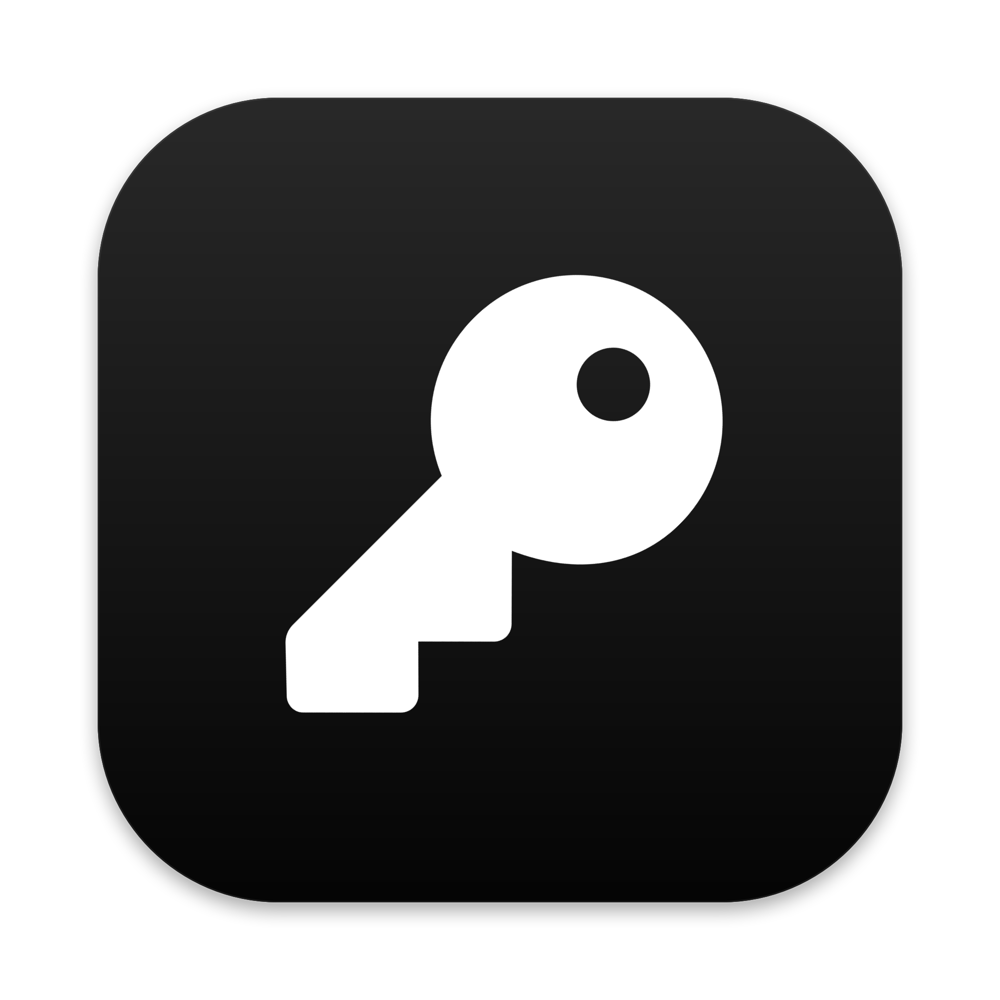

<p align="center"></p>

<p align="center"><a href="README.md">English</a> · Español</p>

# Hush

Gestor de contraseñas para macOS, nativo (Swift y SwiftUI), sobre archivos **KDBX**: el formato abierto de KeePass. Tu base es un archivo cifrado que guardas donde quieras (iCloud Drive, Dropbox, un USB) y que puedes abrir también con otras apps compatibles, en el Mac o en el móvil. Sin cuentas, sin servidores y sin suscripción.

> **Beta.** Lo uso a diario, pero no ha pasado una auditoría externa. Haz copias de tu base antes de probarlo.

## Qué hace

- Desbloqueo con contraseña maestra, archivo de clave o Touch ID (con el Secure Enclave).
- Varias bases abiertas a la vez, búsqueda, favoritos, grupos, papelera e historial de cambios con comparar y restaurar.
- Códigos 2FA (TOTP), tarjetas, notas seguras, adjuntos y referencias entre entradas.
- Generador de contraseñas y frases (en español o en inglés, según el idioma de la app).
- Auditoría: contraseñas filtradas (Have I Been Pwned con k-anonimato: solo salen 5 caracteres del hash), repetidas, parecidas, débiles y webs que admiten 2FA.
- Búsqueda rápida con atajo global (⇧⌘Espacio) e icono en la barra de menús.
- Autorrelleno en el navegador (Chrome, Brave, Edge, Arc, Helium, Vivaldi, Opera, Firefox y Zen).
- Exportar a CSV o .zip con adjuntos, con aviso de que van sin cifrar.

## Compilar

Requiere macOS 15 o posterior y las herramientas de línea de comandos de Xcode (Swift 6.1).

```sh
swift test                      # tests
./build-app.sh                  # compila, firma e instala en ~/Applications/Hush.app
CONFIG=debug ./build-app.sh     # versión de pruebas en build/, sin instalar
```

Para firmar, pon tu certificado en la variable `SIGN_IDENTITY` o en un archivo `.sign-identity` (no se sube a git). Sin certificado se firma ad hoc: la app funciona, pero Touch ID y el llavero necesitan una firma estable.

## Extensión del navegador

Hush copia la extensión en `~/Library/Application Support/Hush/Extension` y registra el puente de mensajería nativa en los navegadores instalados. Las instrucciones están en **Ajustes → Navegadores**.

- **Chrome y derivados:** carga la carpeta `chromium` como extensión sin empaquetar (modo desarrollador).
- **Firefox y Zen:** instala `Hush.xpi` desde *Complementos → Instalar complemento desde archivo*. Como aún no está firmada por Mozilla, hay que poner `xpinstall.signatures.required` en `false` (Zen, Firefox Developer Edition o Nightly).

La extensión todavía no está en las tiendas de Chrome ni de Firefox. Hasta entonces, cualquier programa con tu usuario podría modificar sus archivos: tenlo en cuenta.

## Seguridad

- La base nunca sale de tu Mac sin cifrar. Hush no tiene servidor.
- Antes de guardar, comprueba que el archivo nuevo se vuelve a abrir. Si un guardado falla, los cambios se dejan en una copia cifrada aparte.
- Al bloquear se borran de memoria la clave y los datos, el portapapeles (si lo puso Hush) y los adjuntos abiertos.
- La extensión no guarda contraseñas: las pide a Hush en el momento de rellenar. Solo ofrece las cuentas de la web abierta (dominio registrable según la [Public Suffix List](https://publicsuffix.org)), nunca da una contraseña de https a una página http e ignora los eventos que fabrica la página.
- Hush solo acepta el puente del navegador si lo ha abierto un navegador firmado por su fabricante y conectado directamente a él. Cada navegador se empareja con tu permiso.
- Lo que Hush **no** protege: un Mac ya infectado con malware que corre con tu usuario.

Si encuentras un fallo de seguridad, mira [SECURITY.md](SECURITY.md). Para contribuir, [CONTRIBUTING.md](CONTRIBUTING.md).

## Idiomas

Hush usa el idioma del Mac: español, inglés, alemán, francés, italiano y portugués (Brasil). Las traducciones están en `Resources/i18n/<idioma>.json`; para añadir o corregir una, mira [CONTRIBUTING.md](CONTRIBUTING.md#translations).

## Créditos

- [KDBXKit](https://github.com/shadone/KDBXKit) (BSD 2-Clause), copia en `Vendor/KDBXKit` con un parche de fechas.
- Argon2 (CC0 / Apache 2.0), incluido en KDBXKit.
- [Public Suffix List](https://publicsuffix.org) (MPL 2.0), en `Sources/BovedaCore/PublicSuffixData.swift`.
- [EFF Large Wordlist](https://www.eff.org/dice) (CC BY 3.0 US) para las frases en inglés, y la lista en español de [diceware](https://github.com/ulif/diceware).

## Licencia

[MIT](LICENSE) · [English](README.md)
