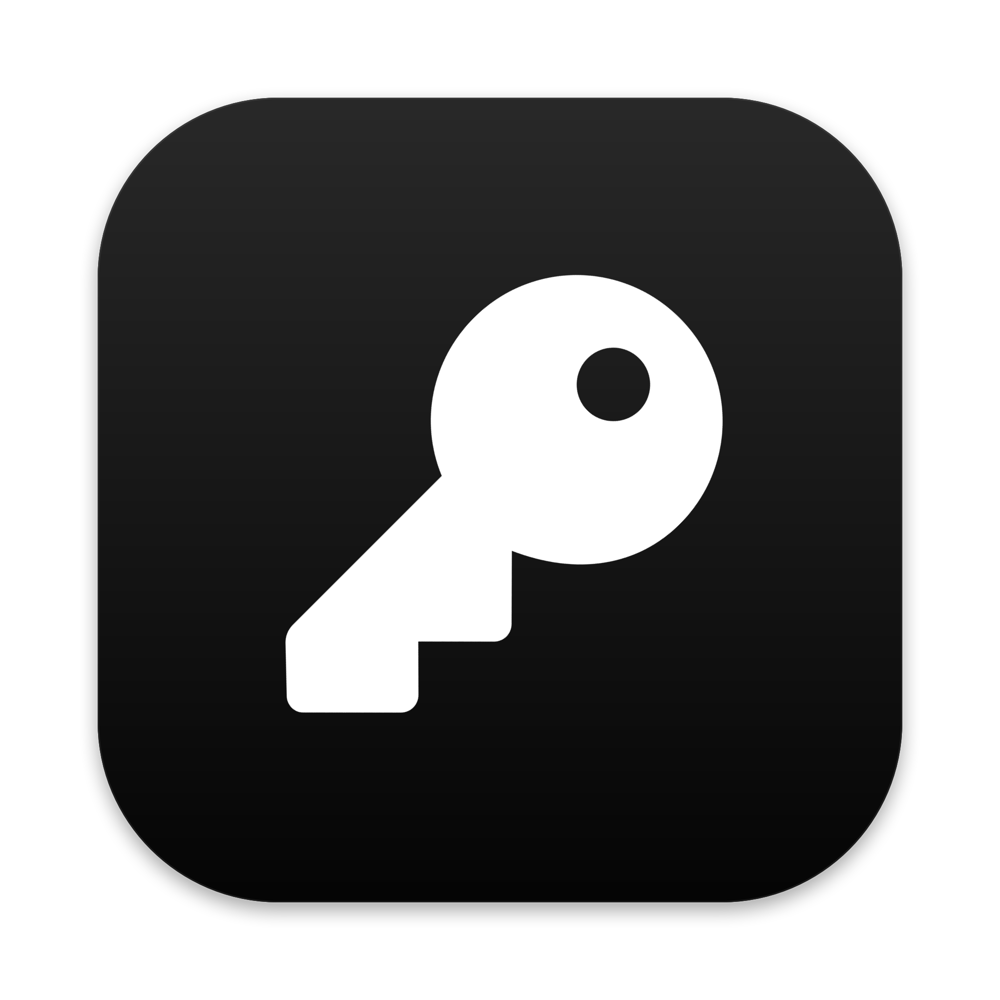

<p align="center"></p>

<p align="center">English · <a href="README.es.md">Español</a></p>

# Hush

A native macOS password manager (Swift and SwiftUI) built on **KDBX** files, the open KeePass format. Your vault is an encrypted file you keep wherever you want (iCloud Drive, Dropbox, a USB stick) and can also open with other compatible apps on your Mac or phone. No accounts, no servers, no subscription.

> **Beta.** I use it every day, but it has not had an external security audit. Back up your vault before trying it. The app UI is in Spanish.

## Features

- Unlock with a master password, a key file or Touch ID (backed by the Secure Enclave).
- Several vaults open at once, search, favorites, groups, recycle bin and entry history with compare and restore.
- 2FA codes (TOTP), cards, secure notes, attachments and field references.
- Password and passphrase generator.
- Audit: breached passwords (Have I Been Pwned with k-anonymity: only 5 characters of the hash leave your Mac), reused, similar and weak passwords, and sites that support 2FA.
- Quick search with a global shortcut (⇧⌘Space) and a menu bar icon.
- Browser autofill (Chrome, Brave, Edge, Arc, Helium, Vivaldi, Opera, Firefox and Zen).
- Export to CSV or .zip with attachments, with a warning that they are not encrypted.

## Build

Requires macOS 15 or later and the Xcode command line tools (Swift 6.1+).

```sh
swift test                      # tests
./build-app.sh                  # build, sign and install to ~/Applications/Hush.app
CONFIG=debug ./build-app.sh     # test build in build/, not installed
```

To sign, put your certificate name in the `SIGN_IDENTITY` variable or in a `.sign-identity` file (ignored by git). Without one the app is signed ad hoc: it runs, but Touch ID and the Keychain need a stable signature.

## Browser extension

Hush copies the extension to `~/Library/Application Support/Hush/Extension` and registers the native messaging bridge in the installed browsers. Instructions are in **Ajustes → Navegadores** (Settings → Browsers).

- **Chrome and Chromium-based browsers:** load the `chromium` folder as an unpacked extension (developer mode).
- **Firefox and Zen:** install `Hush.xpi` from *Add-ons → Install Add-on From File*. It is not signed by Mozilla yet, so `xpinstall.signatures.required` must be `false` (Zen, Firefox Developer Edition or Nightly).

The extension is not in the Chrome or Firefox stores yet. Until then, any program running as your user could modify its files: keep that in mind.

## Security

- Your vault never leaves your Mac unencrypted. Hush has no server.
- Before saving, Hush checks that the new file opens again. If a save fails, changes are kept in a separate encrypted copy.
- Locking wipes the key and data from memory, the clipboard (if Hush put something there) and opened attachments.
- The extension stores no passwords: it asks Hush at fill time. It only offers accounts for the open site (registrable domain according to the [Public Suffix List](https://publicsuffix.org)), never sends an https password to an http page and ignores events synthesized by the page.
- Hush only accepts the bridge when it was launched by a browser signed by its vendor and is connected directly to it. Each browser is paired with your permission.
- What Hush does **not** protect against: a Mac already infected with malware running as your user.

Found a security issue? See [SECURITY.md](SECURITY.md). Want to contribute? See [CONTRIBUTING.md](CONTRIBUTING.md).

## Credits

- [KDBXKit](https://github.com/shadone/KDBXKit) (BSD 2-Clause), vendored in `Vendor/KDBXKit` with a date patch.
- Argon2 (CC0 / Apache 2.0), included in KDBXKit.
- [Public Suffix List](https://publicsuffix.org) (MPL 2.0), in `Sources/BovedaCore/PublicSuffixData.swift`.

## License

[MIT](LICENSE)
